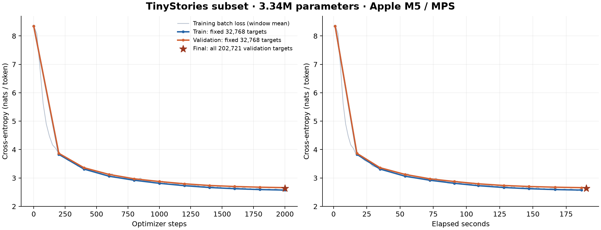

# Recorded core run — 2026-10-15

Status: the real TinyStories training-to-generation chain completed. The 12-step
smoke run, synthetic unit tests and formal 2,000-step run are separate records.
No OWT run, leaderboard attempt, ablation sweep or extended hyperparameter search
was performed after reaching this goal.

## Data and tokenizer

Source: `roneneldan/TinyStories`, `TinyStoriesV2-GPT4-{train,valid}.txt`, revision
`f54c09fd23315a6f9c86f9dc80f725de7d8f9c64`. See [data-manifest.json](data-manifest.json)
for immutable source URLs, hashes and processing details.

| Item | Recorded value |
|---|---:|
| Selected train stories | 20,000 |
| Selected validation stories | 1,000 |
| Exact train/valid document overlaps removed | 0 |
| BPE training stories (train split only) | 2,000 |
| BPE training text bytes | 1,651,850 |
| Vocabulary size | 4,096 |
| Train / validation tokens | 4,124,075 / 202,722 |
| BPE training time | 1.485 s |
| Train / validation encoding time | 7.968 / 0.403 s |
| Token storage | NumPy uint16, memory mapped during training |

This is a deterministic prefix subset, not a uniformly random sample or the full
TinyStories dataset. The source files are independent train/valid splits. Exact
document overlap checks do not establish absence of semantic near-duplicates.
Text normalization strips only document-edge whitespace and appends EOS/newline.

## Model and optimization

4 pre-norm Transformer blocks, d_model=192, 6 heads, head dimension=32, d_ff=512,
context=256, vocabulary=4096. RMSNorm, RoPE(theta=10000), SwiGLU, causal attention,
separate input embeddings and output projection. **3,344,064 parameters**.

Apple M5 / 16 GiB, macOS 26.5.2, Python 3.12.15, PyTorch 2.11.0, MPS float32.
No pretrained LM weights, mixed precision, torch.compile or gradient accumulation.
Batch=8, 2,000 optimizer updates, 2,048 tokens/update, 4,096,000 total training
tokens sampled as random windows with replacement (not one exact sequential epoch).
AdamW beta=(0.9,0.95), weight_decay=0.1, clipping norm=1.0; LR 100-step warmup to
0.001, then cosine decay to 0.0001. Seed=336. Full config: [config.json](config.json).

## Observed measurements

| Metric | Initial | Final |
|---|---:|---:|
| Train NLL on fixed 32,768 targets | 8.350082 | 2.574259 |
| Validation NLL on fixed 32,768 targets | 8.349492 | 2.659469 |
| Final train batch-loss mean (last 25 updates) | — | 2.613499 |
| NLL on all 202,721 selected-validation targets | — | **2.633829** |
| Perplexity on those same targets | — | **13.926994** |

NLL uses natural logarithms; PPL=exp(NLL). Final validation covers every next-token
target in the selected validation token stream, including the final partial window,
and aggregates losses by token count. It is not the loss on the entire official
validation dataset. Training diagnostic loss is not a full-training-corpus evaluation.

The recorded run took **190.231 seconds** from the run timer start through final
validation and checkpoint operations, excluding download/preprocessing, model/data
setup, unit tests and generation. It has not been presented as optimizer-only time.
The training loop's last update was logged at 185.677 seconds.

[metrics.jsonl](metrics.jsonl) contains the actual events; [summary.json](summary.json)
contains the final metrics. [reloaded-validation.json](reloaded-validation.json)
records the separate full-validation pass after reloading `last.pt` from disk.

## Generation from the actual final checkpoint

Checkpoint: `runs/tinystories-m5/last.pt`, iteration 2,000, SHA-256
`fd1b0e010d3d382e8e354fe02f059e1e03aadb5edcc3e76f6b53e800554635c7`.
The same prompt and seed were fixed for three runs; all outputs, including weak
ones, are retained. Prompt: `Once upon a time, there was a little rabbit`.

| Setting | New tokens, including EOS | Stop | Exact record |
|---|---:|---|---|
| Greedy, temperature=0 | 196 | EOS | [sample-greedy.json](sample-greedy.json) |
| temperature=0.8, top-p=0.9 | 121 | EOS | [sample-t08-p09.json](sample-t08-p09.json) |
| temperature=1.1, top-p=0.95 | 180 | EOS | [sample-t11-p095.json](sample-t11-p095.json) |

The 0.8 / 0.9 output, verbatim including the prompt:

> Once upon a time, there was a little rabbit named Bob. Bob loved to watch him play with his friends. One day, he saw a big, red ball in the park.
> As he went outside, he saw a big bird named Tim. Tim said, "Hi, I can help you. I will help you find the ball." So, Bob and Sam were very happy. They played with the ball all day long.
> After a while, Bob and Tim found the ball. They all played together and having fun. They were happy they learned to be more careful and keep them safe. And they all lived happily ever after.<|endoftext|>

The model learned simple story structure but has clear limitations: Bob/Tim/Sam
are not consistently tracked, some pronouns and grammar are wrong, greedy output
repeats phrases, and the hotter sample becomes substantially less coherent. These
are observations from a small run, not proof of general language understanding.
The three configurations demonstrate that decoding works; they do not isolate the
causal effect of temperature versus top-p, because both vary in the sampled cases.

## Verification and scope

- Existing official test files: 46 passed, 2 platform skips on macOS.
- Existing extra tests: 50 passed.
- New pipeline integration tests: 4 passed.
- Total: 100 passed, 2 skipped. The original Linux-only tokenizer memory checks
  remain unverified on macOS.
- CPU deterministic test: split/resumed training matches uninterrupted model,
  optimizer and sampling RNG state exactly.
- Real TinyStories MPS smoke: stopped at step 6, reloaded, continued to step 12,
  validated and generated. This tiny smoke model is not the reported formal model.
- Formal final checkpoint reloaded successfully for validation and all three
  generations. All three naturally emitted EOS before the 256-token cap.

This completes the requested core pipeline, not the complete handout. Not performed:
full-data 10K/32K vocabulary experiments, the full TinyStories training budget/loss
target, extensive learning-rate or batch-size sweeps, architecture ablations, OWT,
leaderboard, and all written exercises. The walkthrough in
[CORE_WALKTHROUGH.md](../../docs/CORE_WALKTHROUGH.md) explains the full data flow and
suggests a seven-slide presentation structure.
